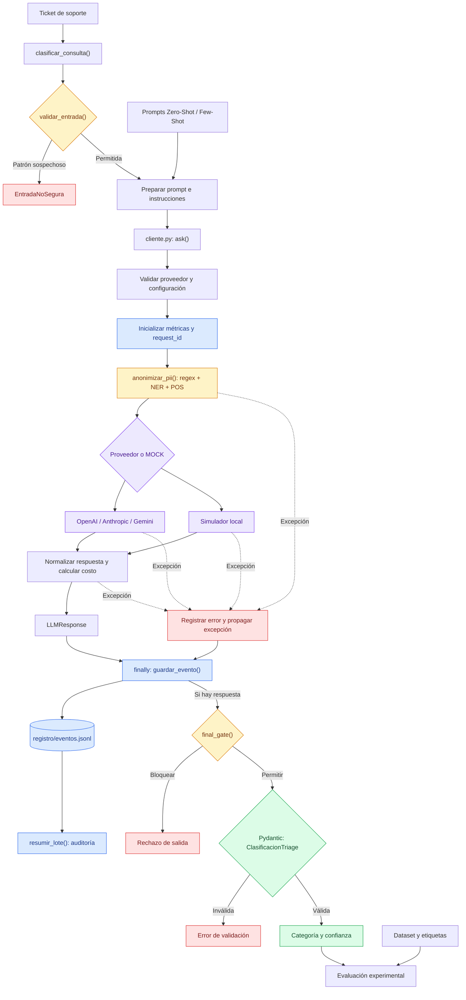

# Nubbix — Sistema de clasificación de tickets con LLM

## 1. Descripción del proyecto

Proyecto de ingeniería de IA orientado a automatizar la clasificación de consultas de soporte técnico de Nubbix, una empresa SaaS ficticia que brinda servicios a pequeñas y medianas empresas de Latinoamérica.

El sistema utiliza modelos de lenguaje (LLM) para clasificar consultas de clientes en cuatro categorías:

- `billing`: facturación y pagos.
- `technical`: problemas técnicos.
- `account`: gestión de cuentas.
- `other`: consultas generales u otras solicitudes.

La solución contempla distintos proveedores LLM, ingeniería de prompts, evaluación cuantitativa, validación estructurada con Pydantic, control de costos, telemetría persistente por lote y mecanismos heurísticos de seguridad y enmascaramiento local de información personal (PII).

## 2. Arquitectura

El proyecto está organizado en cuatro componentes principales:

- **M1P1/**: núcleo de la aplicación y lógica de clasificación.
- **data/**: datasets, etiquetas y predicciones.
- **prompts/**: versiones de los prompts utilizados.
- **pasos/**: scripts experimentales y pruebas de cada etapa.

### Ciclo de vida del ticket



El diagrama representa el flujo de `clasificar_consulta()`. Los scripts que llaman directamente a `ask()` también reciben protección PII y telemetría, pero no necesariamente pasan por la validación de entrada, la compuerta de salida o Pydantic.

## 3. Estructura del proyecto

```text
M1P1/
├── M1P1/
│   ├── __init__.py
│   ├── cliente.py
│   ├── config.py
│   ├── clasificacion.py
│   ├── esquema.py
│   ├── datos.py
│   ├── prompts.py
│   ├── costos.py
│   ├── pricing.json
│   ├── tokenizadores.py
│   ├── reintentos.py
│   ├── security.py
│   ├── telemetria.py
│   ├── mock.py
│   └── evaluacion.py
├── data/
│   ├── dataset.py
│   ├── consultas.json
│   ├── etiquetas.json
│   ├── consultas_dev.json
│   ├── etiquetas_dev.json
│   ├── consultas_holdout.json
│   ├── etiquetas_holdout.json
│   ├── predicciones_v1ZeroShot.json
│   ├── predicciones_v1ZeroShot_pydantic.json
│   ├── predicciones_v2FewShot.json
│   └── guia_etiquetado.md
├── prompts/
│   ├── triage_v1ZeroShot.txt
│   ├── triage_v2FewShot.txt
│   └── CHANGELOG.md
├── pasos/
│   ├── comun.py
│   ├── prueba_paso1_cliente.py
│   ├── prueba_paso2_clienteTokens.py
│   ├── prueba_paso3_ratelimits.py
│   ├── prueba_paso4_etiquetado.py
│   ├── prueba_paso5_divisionDataset.py
│   ├── prueba_paso6_triageZeroShot.py
│   ├── prueba_paso7_evaluacionZeroShot.py
│   ├── prueba_paso8_metricasZeroShot.py
│   ├── prueba_paso9_evaluacionFewShot.py
│   ├── prueba_paso10_metricasFewShot.py
│   ├── prueba_paso11_comparativaPrompts.py
│   ├── prueba_paso12_esquema.py
│   ├── prueba_paso13_evaluacionPydantic.py
│   ├── prueba_paso14_clasificacion.py
│   └── prueba_paso15_seguridad.py
├── registro/                     # Generado localmente (excluido de Git)
│   └── eventos.jsonl
├── .env.example
├── .gitignore
├── requirements.txt
└── README.md
```

## 4. Módulos principales

| Archivo | Responsabilidad |
|---|---|
| `cliente.py` | Abstracción de los proveedores LLM. Normaliza respuestas, tokens, latencia y costos. Implementa adaptadores para OpenAI, Anthropic y Gemini. |
| `config.py` | Carga las variables de entorno, modelos, credenciales y parámetros de ejecución. |
| `clasificacion.py` | Orquesta la clasificación de consultas, validación de entradas y salidas y manejo de errores. |
| `esquema.py` | Define el modelo Pydantic `ClasificacionTriage`, con categoría y nivel de confianza. |
| `datos.py` | Funciones para cargar consultas, etiquetas y recuperar consultas individuales. |
| `prompts.py` | Carga, formatea y renderiza las diferentes versiones de prompts. |
| `costos.py` | Consulta las tarifas y calcula costos de procesamiento. |
| `tokenizadores.py` | Conteo de tokens para OpenAI y Gemini. |
| `reintentos.py` | Manejo de errores recuperables, `Retry-After`, backoff exponencial y jitter. |
| `security.py` | Detección heurística de prompt injection, control de salidas y enmascaramiento local de PII mediante regex y spaCy. |
| `telemetria.py` | Persistencia de eventos JSONL con `guardar_evento()` y auditoría con `resumir_lote()`. |
| `mock.py` | Simulación de proveedores para pruebas sin consumir API. |
| `pricing.json` | Datos de tarifas utilizados para estimar costos. |
| `evaluacion.py` | Archivo reservado para evaluación; actualmente vacío. |

## 5. Dataset

Se construyó un dataset sintético de 100 consultas, utilizando Faker y generación aleatoria.

Distribución:

- 25 consultas de facturación.
- 25 consultas técnicas.
- 25 consultas de gestión de cuentas.
- 25 consultas generales.

La división del dataset es estratificada:

| Conjunto | Consultas | Distribución |
|---|---:|---|
| Desarrollo (dev) | 80 | 20 por categoría |
| Evaluación final (holdout) | 20 | 5 por categoría |
| Total | 100 | 25 por categoría |

El archivo `guia_etiquetado.md` contiene los criterios utilizados para asignar las etiquetas.

El conjunto holdout debe permanecer separado durante el desarrollo y utilizarse para la evaluación final, evitando ajustar los prompts con sus resultados.

## 6. Ingeniería de prompts

Se implementaron dos estrategias:

- **Zero-Shot:** clasificación sin ejemplos explícitos.
- **Few-Shot:** clasificación mediante ejemplos representativos de cada categoría.

Los prompts se encuentran en `prompts/`.

El archivo `CHANGELOG.md` registra la evolución de las versiones.

## 7. Evaluación experimental

Las evaluaciones realizadas sobre el conjunto de desarrollo (80 consultas) arrojaron:

| Métrica | Zero-Shot | Few-Shot |
|---|---:|---:|
| Accuracy | 98,75 % | 97,50 % |
| Predicciones correctas | 79/80 | 78/80 |
| Errores de procesamiento | 0 | 0 |

Los errores de clasificación se concentraron en consultas técnicas confundidas con consultas de gestión de cuentas.

La comparación de prompts mostró que Zero-Shot consiguió resultados ligeramente superiores utilizando menos tokens de entrada.

Por lo tanto, se seleccionó Zero-Shot como estrategia inicial.

**Nota:** estos resultados corresponden al conjunto de desarrollo y no representan todavía una evaluación independiente sobre holdout. Fueron obtenidos antes de incorporar el enmascaramiento PII; queda pendiente repetir la evaluación con el flujo actualizado.

### Telemetría y trazabilidad persistente

`ask()` registra eventos de éxito o error en `registro/eventos.jsonl` desde su bloque `finally`, una vez iniciada la ejecución instrumentada. Los eventos incluyen `request_id`, `batch_id` (opcional), `timestamp` UTC, `provider`, `model`, `status`, `error_type`, `latency` (segundos), `input_tokens`, `output_tokens` y `cost_usd`.

El identificador de lote se genera una sola vez antes del bucle de evaluación Zero-Shot. `resumir_lote(batch_id)` calcula cantidad de consultas, éxitos, fallos, latencia total y promedio y costo acumulado registrado.

La prueba con dos consultas MOCK y el lote `LOTE-PRUEBA-001` produjo dos eventos exitosos, una latencia total de 0,843 s, una latencia promedio de 0,421 s y un costo simulado de USD 0,00468. No hubo cargos reales por este lote.

**Limitaciones:** los costos son estimaciones según `pricing.json`, sin ajuste por caché; un costo desconocido no equivale a una llamada gratuita. La telemetría no distingue todavía explícitamente los eventos MOCK de los reales. Los errores previos al bloque instrumentado y los errores posteriores de validación Pydantic no quedan necesariamente registrados. Los fallos de escritura pueden provocar pérdida de eventos.

## 8. Validación estructurada con Pydantic

Se implementó `ClasificacionTriage` para validar las respuestas del modelo.

El esquema establece:

- `category`: solamente admite las cuatro categorías definidas.
- `confidence`: valor numérico entre 0 y 1.
- `extra="forbid"`: rechaza campos adicionales.

En la evaluación realizada sobre 80 consultas, las 80 respuestas fueron validadas correctamente por Pydantic.

## 9. Seguridad

El módulo `security.py` incorpora controles heurísticos para:

- Detectar patrones conocidos de prompt injection.
- Rechazar determinadas entradas sospechosas.
- Delimitar las instrucciones y los datos del usuario.
- Revisar las salidas del modelo antes de aceptarlas.

Estos controles son defensas básicas basadas en patrones. No constituyen una protección completa contra prompt injection ni reemplazan controles de seguridad adicionales.

### Protección de información personal (PII)

`anonimizar_pii()` procesa localmente el prompt del usuario antes de invocar el adaptador o simulador:

- Correos electrónicos: expresiones regulares y sustitución por `[EMAIL]`.
- DNI argentinos con o sin puntos: expresiones regulares y sustitución por `[DNI]`.
- Nombres de personas: reconocimiento de entidades (NER) mediante `es_core_news_sm` de spaCy y sustitución por `[NOMBRE]`.
- Filtrado POS: descarta entidades personales de un solo token etiquetado como verbo para reducir ciertos falsos positivos.

Las pruebas de seguridad incluyen detección de PII, conservación de consultas sin datos personales y comprobación del prompt recibido por un adaptador simulado.

El enmascaramiento es heurístico: puede producir falsos positivos y negativos, no constituye anonimización garantizada y no cubre automáticamente datos personales presentes en el mensaje `system` u otras fuentes externas. Los archivos de telemetría se mantienen fuera de Git mediante `.gitignore`.

## 10. Scripts experimentales

Los scripts de `pasos/` representan las distintas etapas del desarrollo:

| Script | Objetivo |
|---|---|
| `paso1_cliente` | Prueba de comunicación con proveedores LLM. |
| `paso2_clienteTokens` | Conteo y análisis de tokens. |
| `paso3_ratelimits` | Experimentación con límites de solicitudes y streaming. |
| `paso4_etiquetado` | Revisión del etiquetado del dataset. |
| `paso5_divisionDataset` | Validación y división estratificada de datos. |
| `paso6_triageZeroShot` | Clasificación utilizando Zero-Shot. |
| `paso7_evaluacionZeroShot` | Generación y almacenamiento de predicciones Zero-Shot. |
| `paso8_metricasZeroShot` | Cálculo de métricas Zero-Shot. |
| `paso9_evaluacionFewShot` | Generación y almacenamiento de predicciones Few-Shot. |
| `paso10_metricasFewShot` | Cálculo de métricas Few-Shot. |
| `paso11_comparativaPrompts` | Comparación de resultados y consumo de tokens. |
| `paso12_esquema` | Prueba del esquema Pydantic. |
| `paso13_evaluacionPydantic` | Evaluación de respuestas estructuradas. |
| `paso14_clasificacion` | Prueba del flujo integrado de clasificación. |
| `paso15_seguridad` | Pruebas de los controles de seguridad. |

`comun.py` contiene funciones auxiliares compartidas por los scripts experimentales.

## 11. Instalación y configuración

### Requisitos

- Python 3.10 o superior.
- Git.
- Una API key de los proveedores que se quieran utilizar.

### Clonar el repositorio

```bash
git clone https://github.com/LittleOrion1/nubbix-llm-triage.git
cd nubbix-llm-triage
```

### Crear entorno virtual

```bash
python -m venv .venv
source .venv/bin/activate
```

### Instalar dependencias

```bash
pip install -r requirements.txt
python -m spacy download es_core_news_sm
```

### Configurar variables de entorno

Crear un archivo `.env` a partir de la plantilla:

```bash
cp .env.example .env
```

Editar `.env` y completar las credenciales correspondientes.

Para ejecutar pruebas sin consumir API:

```env
ORBITAIR_MOCK=1
```

Para utilizar proveedores reales:

```env
ORBITAIR_MOCK=0
OPENAI_API_KEY=tu_clave
```

Las credenciales son privadas y no deben subirse al repositorio.

## 12. Ejecución

Los scripts se ejecutan desde la raíz del proyecto mediante módulos Python.

Ejemplo:

```bash
python -m pasos.prueba_paso1_cliente
```

Para ejecutar las pruebas de clasificación y seguridad:

```bash
python -m pasos.prueba_paso14_clasificacion
ORBITAIR_MOCK=1 python -m pasos.prueba_paso15_seguridad
```

Consultar los scripts de `pasos/` para conocer el orden y los requisitos de cada experimento.

### Prueba de telemetría por lote sin consumir API

```bash
ORBITAIR_MOCK=1 python -c '
import uuid
from M1P1.cliente import ask
from M1P1.telemetria import resumir_lote

batch_id = str(uuid.uuid4())
for _ in range(2):
    ask(provider="openai", prompt="No puedo acceder a mi cuenta", batch_id=batch_id)
print(resumir_lote(batch_id))
'
```

Los eventos se pueden inspeccionar con `tail -n 5 registro/eventos.jsonl`. Los costos del ejemplo son simulados.

## 13. Tecnologías utilizadas

- Python
- OpenAI API
- Google Gemini API
- Anthropic API
- Pydantic
- Faker
- NumPy
- Tiktoken
- Python-dotenv
- spaCy (NER y POS Tagging)
- JSON Lines (JSONL), regex y UUID
- Git y GitHub

## 14. Estado del proyecto

El proyecto cuenta con:

- Integración de proveedores LLM.
- Dataset sintético etiquetado.
- División de desarrollo y holdout.
- Comparación Zero-Shot y Few-Shot.
- Evaluación de métricas.
- Validación estructurada con Pydantic.
- Manejo de errores recuperables y rate limits.
- Controles heurísticos de seguridad.
- Enmascaramiento local de PII y pruebas de privacidad.
- Telemetría persistente con trazabilidad individual y por lote.
- Diagrama Mermaid del ciclo de vida del ticket.

El siguiente paso de evaluación es medir el rendimiento final utilizando exclusivamente el conjunto holdout.
